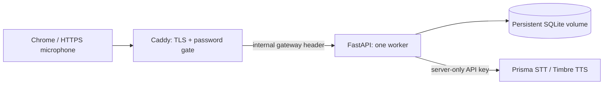

# Private HTTPS demo deployment

Deployment configuration is prepared, not deployed. No GitHub push or hosting change has been made. Obtain the owner's explicit authorization before running a deployment command or publishing source.

## Intended scope

One trusted owner/evaluator demo with one shared inbox, one Uvicorn worker and SQLite on a persistent named volume. This is not a public multi-user messaging service. All evaluators with the demo password share the same data; use synthetic examples only.



## Files and protections

- `Dockerfile`: non-root app, pinned runtime packages, health check, one worker, no application secrets copied into the image.
- `.dockerignore`: allowlisted build context; excludes `.env`, user data, recordings, tests and local environments.
- `compose.yaml`: only Caddy publishes ports; the app's root filesystem is read-only, `/tmp` is bounded, and `/data` is a persistent volume.
- `deploy/Caddyfile`: automatic HTTPS, hashed-password authentication on every proxied route, 9 MB request-body limit, removal of the browser's Basic Authorization header before forwarding, and a private gateway header.
- Production app: requires explicit hosts, a strong gateway token and Gnani credentials; rejects direct unauthenticated API/data access, untrusted hosts and non-HTTPS requests. Existing same-origin checks and microphone policy remain enabled.

Caddy's [automatic HTTPS](https://caddyserver.com/docs/automatic-https) requires working DNS, reachable ports and persistent certificate storage. Its [Basic Authentication](https://caddyserver.com/docs/caddyfile/directives/basic_auth) requires a password hash and must be used over HTTPS. Trusted forwarded headers are enabled only because the app is inside the private Compose network; do not publish app port 8000 on the host. See [FastAPI's proxy guidance](https://fastapi.tiangolo.com/advanced/behind-a-proxy/).

## Requirements before authorization

1. A Linux host with Docker Engine and Compose v2, administrative access, outbound HTTPS to Gnani/PyPI/container registries, and an owned DNS name.
2. Domain A/AAAA records pointing to that host. Open TCP 80/443 and optionally UDP 443; app port 8000 stays private.
3. A valid Gnani key with speech permissions/credit, a private evaluator username/password, and a separate random gateway token of at least 32 characters.
4. A data retention/backup decision and a way to privately give evaluators the password. No automatic email or message is sent by this project.

## Configure on the deployment host

These are preparation instructions; commands that start services must wait for authorization.

Copy `.env.production.example` to `.env.production` using your editor or file manager. Set domain **without** a scheme/path, evaluator username, Gnani key and model/voice settings. Keep `.env.production` private with owner-only filesystem access.

Generate the password hash interactively, so the plaintext does not appear in shell history:

```powershell
docker run --rm -it caddy:2-alpine caddy hash-password
```

Paste the resulting bcrypt hash into `SAATHI_DEMO_PASSWORD_HASH` inside **single quotes**. Compose treats single-quoted `.env` values literally, preserving the `$` characters ([official interpolation guidance](https://docs.docker.com/compose/how-tos/environment-variables/variable-interpolation/)). Choose the actual password yourself and share it privately; the repository supplies no default login.

Generate a random gateway token locally. It is a server-to-server secret, never an API key or a browser credential:

```powershell
python -c "import secrets; print(secrets.token_urlsafe(48))"
```

Paste it into `SAATHI_PROXY_TOKEN` in the private production environment file. Do not include either secret in screenshots or command output you publish.

Validate without printing resolved environment values:

```powershell
docker compose --env-file .env.production config --quiet
```

Avoid plain `docker compose config` when real secrets are set, because it prints the resolved configuration.

## Start only after explicit authorization

From the approved host checkout, after the owner authorizes deployment:

```powershell
docker compose --env-file .env.production up --build -d
docker compose --env-file .env.production ps
```

Then verify:

1. `http://YOUR_DOMAIN` redirects to HTTPS and a browser-trusted certificate is issued; do not bypass certificate warnings.
2. An incognito request requires evaluator authentication before the application is visible. Incorrect credentials are rejected.
3. After authentication, `/api/health` responds, inbox/summary/draft/reminder actions work, and same-origin writes are accepted through HTTPS.
4. Chrome offers microphone permission for this HTTPS origin. The backend app port is unreachable from the Internet; no frontend request carries the Gnani key or private gateway token.
5. Real Prisma transcription, Timbre playback, explicit confirmations and a due reminder work over the deployed origin.
6. Restart the app container and confirm test records persist. Inspect logs for errors without publishing private request data.

## Storage, backups and rollback

`saathi_data` persists `/data/saathi.db`. Caddy's certificate data/configuration use separate named volumes. A single worker preserves the process-wide Gnani concurrency guard; do not scale replicas while sharing this SQLite file.

To create a consistent SQLite backup inside the private data volume after deployment:

```powershell
docker compose --env-file .env.production exec app python -c "import sqlite3; source=sqlite3.connect('/data/saathi.db'); target=sqlite3.connect('/data/saathi.backup.db'); source.backup(target); target.close(); source.close()"
```

Copy the backup to private encrypted storage using your host's approved backup process and test a restore before relying on it. Do not commit databases or backups. `docker compose down` preserves named volumes; `down --volumes` destroys them and is not a routine rollback step.

Record the approved image/version and back up data before upgrades. Restore the prior tested image and compatible database backup if rollback is needed. Never use a live database from a personal development machine as public demo content.

## Verified here versus remaining work

- **Verified:** production application guards/persistence tests, real Git exclusion rules, Compose syntax (`config --quiet` with validation-only values), Caddy configuration validation using official Caddy 2.11.8, and availability of all 19 pinned Linux/Python 3.12 runtime wheels.
- **Not executed:** Docker image build or container runtime tests, because the local Docker daemon is not running. No production DNS, TLS certificate, gateway login or remote persistence test has occurred.
- **Not deployed:** host/domain, login password/hash, production gateway token and production environment must be configured by the owner, followed by authorization and the deployment acceptance checks above.
- **Limits:** shared single-user data, no per-user isolation or production abuse/rate-limit system, no guaranteed closed/background-tab alarm, no outgoing SMS/WhatsApp/email, no uptime/latency guarantees. Keep the demo restricted to trusted evaluators and monitor account usage.
