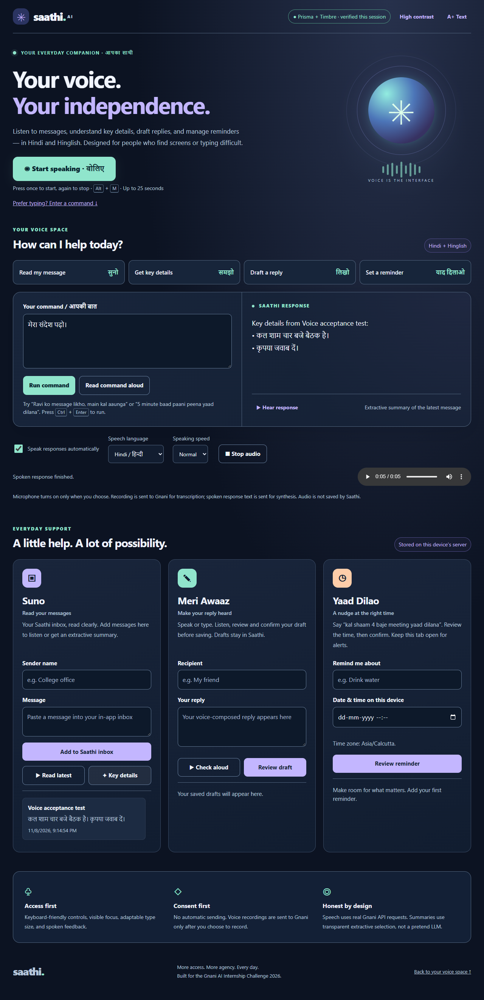
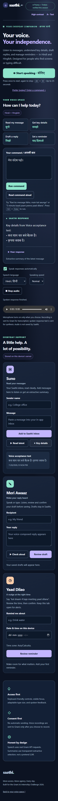
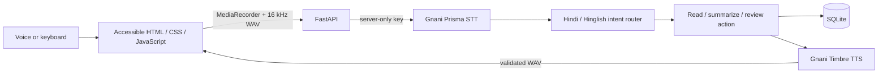

# Saathi AI

**Your voice. Your independence.**  
A Hindi/Hinglish voice companion for visually impaired users and people with limited mobility, prepared for the **Gnani AI Internship Challenge 2026**.

Saathi reads its own inbox, extracts key details, drafts local replies and creates reminders. Real **Gnani Prisma** transcribes speech; real **Gnani Timbre** speaks the response. Users see what was heard and confirm before saving a draft, creating a reminder or marking one done.

[Final pre-submission check / push commands](PRESUBMISSION_CHECK.md) · [60-second demo script](DEMO_SCRIPT.md) · [Submission draft](SUBMISSION.md) · [Verification record](AUDIT.md) · [Deployment](DEPLOYMENT.md) · [Physical voice checklist](VOICE_TESTING.md)

## Screenshots

Actual Chrome screenshots from real Gnani acceptance tests, using only a disposable example inbox. No personal messages or credentials are shown. The microphone input in automated voice tests is genuine generated speech fed through a virtual microphone; the owner also reports a manual real-voice pass.

<details open>
<summary>Desktop voice space</summary>



</details>

<details>
<summary>Mobile layout</summary>



</details>

## What works

| Workflow | Example command | Result |
| --- | --- | --- |
| Read a message | `मेरा संदेश पढ़ो` / `Mera message padho` | Reads the latest message in the Saathi inbox |
| Read recent messages | `Sab messages padho` | Reads up to 30 recent messages |
| Explain key details | `Message ka summary batao` | Extracts up to three sentences from the latest message |
| Summarize recent inbox | `Sab messages ka summary batao` | Extractive details for up to 30 recent messages |
| Draft a reply | `Ravi ko message likho, main aaunga` | Reviews recipient/body, then saves locally after confirmation |
| Create a reminder | `एक मिनट बाद पानी पीना याद दिलाना` | Reviews the actual future time before saving |
| Confirm / cancel | `हाँ` / `haan`, `नहीं` / `nahi` | Applies only to the displayed pending review |
| Stop / help | `stop speaking`, `मदद` | Stops playback or explains supported tasks |

The original FastAPI/SQLite app has been extended in place. There is no replacement frontend framework, fake speech-success mode, browser speech-provider substitution or production provider fixture.

## Accessibility and user control

- At least 48-pixel controls, visible keyboard focus, skip navigation, accessible labels and live status/error messages.
- Hindi/Hinglish transcripts remain editable and visible next to the written response; long responses are keyboard-scrollable.
- Persistent high contrast, larger text, speech language/speed and automatic spoken feedback preferences.
- **Alt+M** starts/stops recording; **Ctrl+Enter** runs the typed command; **Escape** stops/discards recording or cancels a review.
- Confirmation dialogs start on Cancel, wrap Tab/Shift+Tab, offer spoken review/confirmation and return focus when closed.
- One-use, five-minute server-side reviews freeze the proposed action. Retrying the same confirmation cannot create duplicate saves.
- Recording is click-to-toggle, up to 25 seconds. Playback has replay/stop/native controls and sequential chunks for longer text.
- Motion is limited to short transitions and active-listening feedback; reduced-motion and forced-color preferences are respected.

Core manual voice acceptance is reported by the owner. Automated checks do not constitute accessibility certification, a target-user usability study, or a measured recognition-accuracy claim. Human screen-reader acceptance and background-tab behavior still need evaluation within their documented limits.

## Architecture



**Technologies:** Python 3.12, FastAPI, Pydantic, requests, SQLite, HTML/CSS/JavaScript, MediaRecorder/Web Audio, Node's test runner and Playwright/Chrome. Runtime versions are pinned in `requirements.lock`; `requirements.txt` records supported dependency ranges.

Prisma uses the official [STT REST endpoint](https://docs.gnani.ai/api/STT/speech-to-text) with multipart audio and `X-API-Key-ID`. Timbre uses the official [TTS REST endpoint](https://docs.gnani.ai/api/TTS/tts-inference) with real binary WAV output. Default models are `prisma-v3.0` and `timbre-v2.5`, voice `Nalini`. The server validates recordings, sanitizes errors, limits concurrent speech requests and finalizes streamed WAV length fields without altering PCM samples.

## Run on Windows PowerShell

This workspace already has a prepared `.venv`. To start after stopping the existing server:

```powershell
Set-Location -LiteralPath 'D:\Gennai\saathi-ai'
& .\.venv\Scripts\python.exe -m uvicorn app:app --host 127.0.0.1 --port 8000
```

Open **http://127.0.0.1:8000** in Chrome. Keep the terminal and browser tab open. No virtual-environment activation or execution-policy change is needed. Stop with **Ctrl+C**. After editing `.env`, restart the server and refresh Chrome.

For a fresh checkout, install Python 3.12 with the `py` launcher and run from the project folder:

```powershell
py -3.12 -m venv .venv
if ($LASTEXITCODE -ne 0) { throw 'Install Python 3.12 and retry.' }
& .\.venv\Scripts\python.exe -m pip install -r .\requirements.lock
if ($LASTEXITCODE -ne 0) { throw 'Dependency installation failed.' }
& .\.venv\Scripts\python.exe -m pip check
if (-not (Test-Path -LiteralPath '.\.env')) {
    Copy-Item -LiteralPath '.\.env.example' -Destination '.\.env'
}
notepad.exe .\.env
```

Set `GNANI_API_KEY` in that server `.env` using your key from [Gnani's platform](https://app.gnani.ai/voice), save, then start with the command above. Never put the key in frontend files, screenshots or shell command arguments. Without a key, typed inbox/draft/reminder tasks work and speech is explicitly unavailable. `start_windows.bat` is an alternative launcher for Windows.

Check the running backend from another PowerShell window:

```powershell
Invoke-RestMethod -Uri 'http://127.0.0.1:8000/api/health' | Format-List
```

`gnani_configured` checks presence only. Health's `connection_verified=False` means this route itself does not make a paid provider call. The UI reports successful Prisma/Timbre calls only after they actually succeed in that browser session. Browser recording requires localhost or HTTPS and microphone permission.

## Tests and evidence

All final test outcomes, including any failed attempt and its fix, are recorded in [AUDIT.md](AUDIT.md). These are engineering checks, not latency, WER, user-impact or accessibility-certification metrics.

```powershell
& .\.venv\Scripts\python.exe -m pip install -r .\requirements-dev.txt
& .\.venv\Scripts\python.exe -B -m unittest discover -s tests -v
node --test tests/frontend.test.cjs
node --check static/app.js
node --check static/audio.js
```

Normal discovery deliberately skips optional Chrome/live-provider tests. To run the non-billed Chrome suite with installed Chrome:

```powershell
& .\.venv\Scripts\python.exe -m pip install -r .\requirements-e2e.txt
$env:SAATHI_BROWSER_CHANNEL = 'chrome'
$env:SAATHI_E2E = '1'
try {
    & .\.venv\Scripts\python.exe -B -m unittest discover -s tests -p test_browser.py -v
} finally {
    Remove-Item Env:\SAATHI_E2E -ErrorAction SilentlyContinue
    Remove-Item Env:\SAATHI_BROWSER_CHANNEL -ErrorAction SilentlyContinue
}
```

For real billed provider tests and the physical microphone checklist, follow [VOICE_TESTING.md](VOICE_TESTING.md). Live Chrome tests use genuine Gnani-generated speech through a virtual microphone, real API calls and disposable SQLite storage. Unit transport fixtures exist only in tests. GitHub Actions is configured for offline-contract/backend/frontend/Chrome checks, a container build and disposable container auth/storage acceptance; it does not automatically use Gnani credentials, push an image or deploy.

## Deployment and privacy

[RAILWAY_DEPLOYMENT.md](RAILWAY_DEPLOYMENT.md) prepares a single-service Railway demo with Railway HTTPS, application password authentication, one non-root Uvicorn worker, persisted SQLite at `/data/saathi.db` and bounded speech/request quotas. [DEPLOYMENT.md](DEPLOYMENT.md) retains the alternative Compose/Caddy route. Real hosted TLS, microphone/Gnani flows, mounted-volume behavior and production acceptance still require explicit deployment authorization and verification. **No deployment was performed by this preparation.**

`.gitignore` excludes `.env`, production secrets, local runtimes, databases, recordings, caches, logs and private folders. `.dockerignore` allows only app source and pinned requirements into the image. Screenshots contain controlled example data. The owner reports the repository published with green CI on `493627f`; these deployment changes still need review and a fresh green run. Run the staged-source/ZIP checker in [PRESUBMISSION_CHECK.md](PRESUBMISSION_CHECK.md) after staging edits and before publication. Disable Railway autodeploy before pushing preparation changes.

## Scope and limitations

- Reads only messages added to Saathi's inbox; no SMS/WhatsApp/Gmail/OS notification or screen import.
- Drafts are never sent. Summaries are extractive, not LLM-generated.
- Reminders persist but announcements require the open app; background throttling can delay them. No closed-tab push or system-alarm guarantee.
- A bounded intent/time grammar handles supported commands and asks for missing/ambiguous details. Recognition errors can occur; always review names, reply content and time.
- SQLite and the prepared password gate support a restricted single-user evaluator demo, not isolated multi-user accounts or an unrestricted public service.
- Audio/text are sent to Gnani for the requested speech operations. Saathi does not persist recordings in normal operation. Local inbox/draft/reminder data is private and must not be published.

## Submission materials

- [DEMO_SCRIPT.md](DEMO_SCRIPT.md): rehearsable 60-second real demo and honest failure handling.
- [SUBMISSION.md](SUBMISSION.md): problem, target users, solution, technology, impact boundaries and contributor fields requiring owner confirmation.
- [AUDIT.md](AUDIT.md): verification evidence and limitations.
- [VOICE_TESTING.md](VOICE_TESTING.md): automated and manual voice acceptance.
- [DEPLOYMENT.md](DEPLOYMENT.md): authorization-dependent production steps.
- [RAILWAY_DEPLOYMENT.md](RAILWAY_DEPLOYMENT.md): exact Railway variables, volume permissions, password gate and dashboard setup.

Complete the contributor names, record the final video and review the organizer's submission form before the November 10, 2026 target date supplied by the project owner. No metrics, testimonials, organizer acceptance, public URL or publication status have been fabricated.
