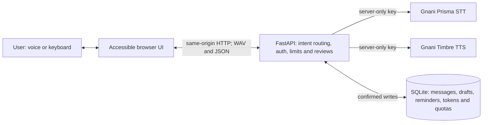

# Saathi AI

**Accessible Hindi/Hinglish voice assistance with real Gnani speech.**

Saathi helps visually impaired users and people with limited mobility read an
in-app inbox, extract key details, draft replies and create reminders. **Gnani
Prisma** transcribes recorded speech; **Gnani Timbre** generates spoken feedback.
Editable transcripts, keyboard controls and explicit confirmation keep the user
in control of every saved action.

This is an existing, working FastAPI application organized as an installable
Python package. It uses real provider calls, not a simulated speech-success mode.
It is prepared for a restricted evaluator demo and an AI engineering portfolio;
it is not an unrestricted multi-user messaging service.

[Demo script](docs/demo/DEMO_SCRIPT.md) ? [Verification](docs/reports/AUDIT.md) ?
[Architecture and refactor](docs/reports/STRUCTURE_REFACTOR.md) ?
[Railway](docs/deployment/RAILWAY_DEPLOYMENT.md) ?
[Compose/Caddy](docs/deployment/DEPLOYMENT.md) ? [Documentation](docs/README.md)

## Features

| Workflow | Example | Implemented behavior |
| --- | --- | --- |
| Read messages | `मेरा संदेश पढ़ो` / `Mera message padho` | Reads the latest message, or up to 30 recent messages on request |
| Extract key details | `Message ka summary batao` | Selects existing sentences; no generative LLM summary |
| Draft a reply | `Ravi ko message likho, main aaunga` | Reviews recipient/body and saves locally only after confirmation; never sends |
| Create a reminder | `एक मिनट बाद पानी पीना याद दिलाना` | Reviews the parsed future timestamp before saving |
| Confirm or cancel | `हाँ` / `haan`, `नहीं` / `nahi` | Applies only to the displayed, expiring, one-use review |
| Typed fallback | Editable transcript and Ctrl+Enter | The same intent and action workflows work without speech credentials |

The interface retains large controls, visible keyboard focus, a skip link,
screen-reader labels/live status, persistent high contrast and larger text,
reduced-motion support, and separate written-action and audio-playback outcomes.
**Alt+M** toggles recording; **Escape** stops/discards recording or cancels review.
Confirmation starts on Cancel and wraps keyboard focus. These engineering checks
do not constitute accessibility certification or intended-user research.

## Screenshots

Actual Chrome captures from previous real-provider acceptance, using disposable
example data. Automated voice tests use genuine generated audio through a virtual
microphone; the owner separately reports successful manual voice testing.


<details>
<summary>Mobile interface</summary>

</details>

## Architecture



The browser records audio and converts it to 16 kHz mono PCM WAV. FastAPI validates
uploads, calls Prisma, routes the returned text through bounded Hindi/Hinglish
intent/time logic and creates frozen action reviews. Timbre returns real audio;
the browser plays it in sequence, keeping the written result available on errors.

Technology: Python/FastAPI/Pydantic, SQLite, Requests, vanilla HTML/CSS/JavaScript,
MediaRecorder/Web Audio, unittest, Node's test runner, Playwright/Chromium, Docker,
GitHub Actions, Railway or Caddy. Runtime dependency versions remain pinned in
`requirements.lock`; `pyproject.toml` defines package metadata and dependencies.

```text
src/saathi/             Python package and bundled static assets
  app.py                HTTP API, database actions and production boundary
  gnani.py              Real Prisma/Timbre HTTP adapter and audio validation
  logic.py              Intent detection, extractive summaries and reminder parsing
  demo_security.py      Application authentication and bounded request controls
  serve.py              Container PORT binding and non-root volume startup
  static/               Existing browser interface
 tests/                 Backend, frontend, browser, security and packaging tests
 tools/                 Password hashing, Docker acceptance and safe release checks
 docs/                  Demo, deployment, reports and screenshots
 deploy/Caddyfile       Alternative HTTPS/password gateway
```

## Run on Windows PowerShell

Use Python 3.12 (the tested runtime) and Chrome. Node 22 is used for frontend tests.
Start from the repository root; retain your existing `.env` and database.

```powershell
Set-Location -LiteralPath 'D:\Gennai\saathi-ai'
if (!(Test-Path -LiteralPath '.venv\Scripts\python.exe')) {
    py -3.12 -m venv .venv
}
& .\.venv\Scripts\python.exe -m pip install -r .\requirements.txt
if ($LASTEXITCODE -ne 0) { throw 'Installation failed.' }
if (!(Test-Path -LiteralPath '.env')) {
    Copy-Item -LiteralPath '.env.example' -Destination '.env'
}
notepad.exe .\.env
& .\.venv\Scripts\python.exe -m uvicorn saathi.app:app --host 127.0.0.1 --port 8000
```

Set `GNANI_API_KEY` privately in the root `.env` for real voice. Never put it in
frontend code, Git, screenshots or shell arguments. Typed features remain usable
with a blank key. Open **http://127.0.0.1:8000** and allow microphone access. The
existing `start_windows.bat` installs the package and starts the same local app.

Editable/source installs resolve optional `.env` and default `saathi.db` at the
checkout root, even when launched from a different directory. A normal installed
wheel uses the working directory for local files, never its package directory.
`SAATHI_DB_PATH` overrides the database path. Existing environment values take
precedence over `.env`; production uses explicit service environment variables.
No local database or credential is migrated by the structural refactor.

`GET /api/health` is a non-billed configuration check. `connection_verified=false`
means health itself does not call Gnani; the UI reports actual speech-call success
separately. Recording requires localhost or trusted HTTPS plus microphone access.

## Test and verify

Run from the repository root:

```powershell
& .\.venv\Scripts\python.exe -m pip install -r .\requirements-e2e.txt
& .\.venv\Scripts\python.exe -B -m unittest discover -s tests -v
node --test tests/frontend.test.cjs
npm run check
& .\.venv\Scripts\python.exe -m pip check
```

To include the non-billed Playwright suite:

```powershell
$env:PLAYWRIGHT_BROWSERS_PATH = Join-Path (Get-Location) '.browser-test\chromium'
& .\.venv\Scripts\python.exe -m playwright install chromium
$env:SAATHI_E2E = '1'
try {
    & .\.venv\Scripts\python.exe -B -m unittest discover -s tests -v
    if ($LASTEXITCODE -ne 0) { throw 'Tests failed.' }
} finally {
    Remove-Item Env:\SAATHI_E2E -ErrorAction SilentlyContinue
}
```

With a running Docker engine, build and exercise actual authentication, PORT,
non-root storage and restart persistence using disposable data:

```powershell
docker build --tag saathi-ai:ci .
if ($LASTEXITCODE -ne 0) { throw 'Build failed.' }
& .\.venv\Scripts\python.exe -B .\tools\container_smoke.py --image saathi-ai:ci
if ($LASTEXITCODE -ne 0) { throw 'Container acceptance failed.' }
```

Exact executed counts, failures/fixes and limits are in
[the refactor report](docs/reports/STRUCTURE_REFACTOR.md) and
[the audit](docs/reports/AUDIT.md). Unit fixtures remain test-only. Billed live
Gnani tests require explicit opt-in; see the [voice checklist](docs/demo/VOICE_TESTING.md).
They are not enabled automatically by CI or these commands.

## Deployment and security

[Railway setup](docs/deployment/RAILWAY_DEPLOYMENT.md) uses the Dockerfile,
application-level password authentication over Railway HTTPS, exact host checks,
one Uvicorn worker/replica and SQLite on a `/data` volume. The startup helper
repairs the root-owned mount and drops to UID/GID 10001 before serving requests.
[Compose/Caddy](docs/deployment/DEPLOYMENT.md) retains its separate gateway-token
boundary, HTTPS/password gate and private application network.

Both modes preserve same-origin mutation checks, restrictive browser headers,
request/upload limits, persistent speech-attempt quotas, timeouts and truthful
failure handling. These demo safeguards are not comprehensive DDoS protection or
a monetary spending guarantee. All authenticated evaluators share the example
inbox. Keep secrets private and verify hosted TLS, voice, storage and backup/restore
after separately authorizing deployment.

The current work belongs to **`refactor/professional-structure`**. No push, merge or
deployment is performed by the refactor. Keep Railway autodeploy disabled while
reviewing it. `.gitignore`, Docker's source allowlist and the release checker
exclude credentials, databases, recordings, local runtimes, caches and build output.

## Scope and competition materials

Saathi reads only its own inbox; it does not import SMS, WhatsApp, email, OS
notifications or screen contents. Drafts are never sent. Reminders persist, but
announcements require the open app and can be delayed by background throttling.
There are no isolated multi-user accounts or guaranteed closed-tab alarms.

The [60-second script](docs/demo/DEMO_SCRIPT.md),
[submission content](docs/demo/SUBMISSION.md),
[physical voice checklist](docs/demo/VOICE_TESTING.md) and
[pre-submission report](docs/reports/PRESUBMISSION_CHECK.md) are retained for the
Gnani AI Internship Challenge target date of November 10, 2026 supplied by the owner.
Contributor fields/final video require owner completion. No user metrics, provider
accuracy figures, testimonials, certification, public deployment URL or organizer
acceptance is fabricated.
